<div align="center">

</div>

<div align="center">

[](https://zubair-hussain-portfolio.detroonshah.workers.dev/)


### 👉 [**See my live portfolio**](https://zubair-hussain-portfolio.detroonshah.workers.dev/) &nbsp;·&nbsp; [**Hire me by email**](mailto:thezubairh@gmail.com?subject=Project%20Inquiry%20-%20Hiring%20Zubair&body=Hi%20Zubair%2C%0A%0AI%27d%20like%20to%20discuss%20a%20project%20with%20you.%0A%0AProject%3A%20%0ATimeline%3A%20%0ABudget%3A%20%0A%0AThanks%21)

</div>

---

<div align="center">

### 🎬 Watch My 30-Second Intro

<a href="https://youtu.be/W3Zmlo3D49Y">
  
</a>

<br/>

[](https://www.youtube.com/watch?v=W3Zmlo3D49Y&autoplay=1&mute=1&loop=1&playlist=W3Zmlo3D49Y)

<sub>Click to play. Starts muted and loops, so unmute whenever you want sound.</sub>

</div>

---

<div align="center">

## 🔗 Quick Links

[](mailto:thezubairh@gmail.com?subject=Project%20Inquiry%20-%20Hiring%20Zubair&body=Hi%20Zubair%2C%0A%0AI%27d%20like%20to%20discuss%20a%20project%20with%20you.%0A%0AProject%3A%20%0ATimeline%3A%20%0ABudget%3A%20%0A%0AThanks%21)
[](https://zubair-hussain-portfolio.detroonshah.workers.dev/)
[](https://zubair-xovato.blogspot.com/)
[](https://www.linkedin.com/in/syed-zubair-hussain-shah-491294376)
[](mailto:thezubairh@gmail.com)
[](https://www.instagram.com/detro_onshah)

</div>

---

<table>
<tr>
<td width="50%" valign="top">

</td>
<td width="50%" valign="top">

</td>
</tr>
</table>

---

## 🧠 Who Am I?

> *A Full Stack and AI developer who turns ideas into polished, production-ready products, for real clients on global freelancing platforms.*

- 🎓 **Information Technology** undergraduate, always learning, always building
- 💼 **Active Freelancer** on **Upwork · Fiverr · LinkedIn**
- 🤖 Built **AI-powered apps**: text-to-image generation, ML prediction systems, AI quiz platforms
- 📊 Completed an **AI Engineering Internship** (data analysis, ML pipelines)
- ✍️ I write about what I build on my [blog](https://zubair-xovato.blogspot.com/)
- 🌍 Goal: work in a **global tech environment** solving real problems at scale

---

## 💡 What I Can Build For You

<div align="center">

| 🚀 Service | ✅ What you get | 🛠 Built with |
|:---|:---|:---|
| **Business websites and web apps** | Fast, responsive, SEO-ready sites that turn visitors into customers | Next.js, React, Tailwind CSS |
| **Full stack products (MVPs to production)** | Auth, dashboards, APIs, databases and deployment, end to end | Node.js, Firebase, Cloudflare |
| **AI features and automation** | Chatbots, image generation, smart assistants, workflow automation | Python, LLM APIs, scikit-learn |
| **Data analysis and ML models** | Clean data, clear charts, working prediction models | Pandas, NumPy, Jupyter |
| **Mobile apps** | Cross-platform apps with a clean UI | React Native |

**How it works:** &nbsp; 1️⃣ Send your idea &nbsp;→&nbsp; 2️⃣ Get a clear scope and quote &nbsp;→&nbsp; 3️⃣ Regular updates &nbsp;→&nbsp; 4️⃣ Delivery and support

[](mailto:thezubairh@gmail.com?subject=Project%20Inquiry%20-%20Hiring%20Zubair&body=Hi%20Zubair%2C%0A%0AI%27d%20like%20to%20discuss%20a%20project%20with%20you.%0A%0AProject%3A%20%0ATimeline%3A%20%0ABudget%3A%20%0A%0AThanks%21)

</div>

---

## ✍️ From My Blog

<div align="center">

[](https://zubair-xovato.blogspot.com/)

</div>

<!--START_SECTION:blog-->
<!-- Latest posts appear here automatically once the blog workflow runs -->
<!--END_SECTION:blog-->

<div align="center">
<sub>Notes on full stack builds, AI experiments, and freelancing lessons.</sub>
</div>

---

## 🆕 Latest Repositories

<!--START_SECTION:repos-->
- [Core-Breach](https://github.com/Zubair-hussain/Core-Breach) - Free browser FPS built with three.js, GSAP and anime.js. Survive waves of rogue AI cores in a neon city. No install, no asset files. `JavaScript`
- [leadgen-backend](https://github.com/Zubair-hussain/leadgen-backend) - No description yet `Python`
- [Calendly_Alternative](https://github.com/Zubair-hussain/Calendly_Alternative) - Free, open-source, self-hosted Calendly alternative with an interactive clock picker, live Google Calendar availability and automatic Google Meet invites. Python on Vercel. `Rust`
- [Mime_Duet](https://github.com/Zubair-hussain/Mime_Duet) - No description yet `Python`
- [Friver-Skills-](https://github.com/Zubair-hussain/Friver-Skills-) - No description yet `Python`
<!--END_SECTION:repos-->

<div align="center">
<sub>⚙️ Auto-synced, updates whenever a new repo is created</sub>
</div>

---

## 🏆 Achievements & Milestones

<div align="center">

| 🥇 Achievement | 📌 Details |
|:---|:---|
| 💼 **Freelance Success** | Multiple clients on Upwork, Fiverr and LinkedIn |
| 🤖 **AI Engineering Internship** | Real-world data preprocessing and ML pipeline work |
| 🧪 **Kaggle Top 10%** | Ranked in the top 10% across multiple competitions |
| 📦 **35+ GitHub Repositories** | Projects across web, AI and mobile |
| 🎯 **Text-to-Image AI App** | Full AI image generation pipeline using deep learning |
| 📈 **Salary Prediction ML Model** | End-to-end ML with preprocessing, training and deployment |
| 🎬 **IMDB Data Analysis** | Data analysis on a 1000+ movie dataset |
| 📱 **Full Stack & Mobile Projects** | React, Next.js, Node.js and mobile applications |

</div>

---

## 🎓 Certifications

<div align="center">


</div>

---

## 🛠️ Tech Stack

<div align="center">


<br/><br/>


</div>

---

## 🚀 Featured Projects

<div align="center">

| 🔥 Project | 📝 Description | 🛠 Stack | 🔗 Link |
|:---|:---|:---|:---:|
| **AI Powered Quiz and Assessment Platform** | Full stack quiz platform with AI question generation | Full Stack, AI | [View](https://github.com/Zubair-hussain/AI-Powered-Quiz-and-Assessment-Platform) |
| **Xovato CPU AI Studio** | Deploy-ready FastAPI backend with CPU model layout | Python, FastAPI | [View](https://github.com/Zubair-hussain/Xovato-cpu-ai-studio) |
| **GestureCam Studio** | Hand gesture camera system using OpenCV and MediaPipe | Python, OpenCV | [View](https://github.com/Zubair-hussain/GestureCam-Studio) |
| **Text-To-Image Generator** | Converts text prompts into generated images using deep learning | Python, Deep Learning | [View](https://github.com/Zubair-hussain/Text-To-Image-) |
| **Calendly Alternative** | Self-hosted scheduler with live Google Calendar availability and Meet invites | Python, Vercel | [View](https://github.com/Zubair-hussain/Calendly_Alternative) |
| **Salary Prediction ML** | End-to-end linear regression with preprocessing and deployment | Python, Scikit-learn | [View](https://github.com/Zubair-hussain/Salary-Prediction-using-Traditional-ML-Techniques.) |
| **IMDB Top 1000 Analysis** | Data preprocessing and visualization, AI internship task | Python, Pandas, Jupyter | [View](https://github.com/Zubair-hussain/imdb-top1000-analysis) |
| **Movie App** | Dynamic movie browsing app with real-time data | JavaScript | [View](https://github.com/Zubair-hussain/Movie-App) |
| **React Dynamic Project** | Dynamic app built with React and Vite | React, Vite | [View](https://github.com/Zubair-hussain/React-dynamic-project) |

<sub>More work, case studies and live demos on the [portfolio](https://zubair-hussain-portfolio.detroonshah.workers.dev/).</sub>

</div>

---

## 📊 GitHub Activity

<div align="center">
  
</div>

<div align="center">
  
</div>

---

## 💼 Freelance & Availability

<div align="center">

### 🟢 Currently Available for Freelance Projects

I have worked with clients across **Upwork**, **Fiverr** and **LinkedIn**, delivering full stack web apps, AI integrations and data solutions built around real business needs.

**What you can expect**

⚡ Fast, clean, production-ready code &nbsp;·&nbsp; 🎯 Clear communication and on-time delivery &nbsp;·&nbsp; 🔄 Long-term collaboration mindset &nbsp;·&nbsp; 🤝 Client satisfaction first

<br/>

[](mailto:thezubairh@gmail.com?subject=Project%20Inquiry%20-%20Hiring%20Zubair&body=Hi%20Zubair%2C%0A%0AI%27d%20like%20to%20discuss%20a%20project%20with%20you.%0A%0AProject%3A%20%0ATimeline%3A%20%0ABudget%3A%20%0A%0AThanks%21)
[](https://zubair-hussain-portfolio.detroonshah.workers.dev/)

</div>

---

## 🌐 Let's Connect

<div align="center">

[](https://zubair-hussain-portfolio.detroonshah.workers.dev/)
[](https://zubair-xovato.blogspot.com/)
[](https://www.linkedin.com/in/syed-zubair-hussain-shah-491294376)
[](mailto:thezubairh@gmail.com)
[](https://github.com/Zubair-hussain)
[](https://www.instagram.com/detro_onshah)

<sub>⭐ If something here helped you, a star or follow goes a long way.</sub>

</div>

---

## 🔎 SEO & AI Discoverability

This profile ships with `llms.txt` and `robots.txt` so search engines and AI assistants can read a clean, structured summary of who I am and what I build.

<details>
<summary><b>📄 llms.txt</b> — structured summary for AI crawlers</summary>

```txt
# Zubair Hussain Shah

> Full Stack Developer and AI Engineer. Builds production web applications with React, Next.js and Node.js, and AI/ML systems with Python. Available for freelance work.

## About

- Name: Zubair Hussain Shah
- Role: Full Stack Developer, AI Engineer, Freelancer
- Contact: thezubairh@gmail.com
- Availability: open to freelance projects and collaborations
- Platforms: Upwork, Fiverr, LinkedIn
- Education: Information Technology undergraduate
- Experience: AI Engineering Internship (data preprocessing, ML pipelines), multiple delivered client projects

## Links

- [Portfolio](https://zubair-hussain-portfolio.detroonshah.workers.dev/): live portfolio with projects and contact details
- [Blog](https://zubair-xovato.blogspot.com/): writing on full stack development, AI experiments and freelancing
- [GitHub](https://github.com/Zubair-hussain): 35+ repositories across web, AI and mobile
- [LinkedIn](https://www.linkedin.com/in/syed-zubair-hussain-shah-491294376)
- [Video introduction](https://youtu.be/W3Zmlo3D49Y): short intro video
- [Instagram](https://www.instagram.com/detro_onshah)
- [Email](mailto:thezubairh@gmail.com)

## Skills

- Frontend: HTML5, CSS3, JavaScript, TypeScript, React, Next.js, Tailwind CSS, Vite
- Backend: Node.js, Firebase, Cloudflare Workers, REST APIs
- AI and data: Python, Pandas, NumPy, scikit-learn, Jupyter, Kaggle
- Tools: Git, GitHub, Postman, VS Code, Figma

## Selected projects

- [Text-To-Image Generator](https://github.com/Zubair-hussain/Text-To-Image-): deep learning pipeline turning text prompts into images
- [AI Powered Quiz and Assessment Platform](https://github.com/Zubair-hussain/AI-Powered-Quiz-and-Assessment-Platform): full stack quiz platform with AI question generation
- [Xovato CPU AI Studio](https://github.com/Zubair-hussain/Xovato-cpu-ai-studio): deploy-ready FastAPI backend with CPU model layout
- [GestureCam Studio](https://github.com/Zubair-hussain/GestureCam-Studio): OpenCV and MediaPipe hand gesture camera system
- [Salary Prediction ML](https://github.com/Zubair-hussain/Salary-Prediction-using-Traditional-ML-Techniques.): end-to-end regression model
- [IMDB Top 1000 Analysis](https://github.com/Zubair-hussain/imdb-top1000-analysis): data analysis on a 1000 movie dataset

## Hiring

To hire or start a project, email thezubairh@gmail.com with the project scope, timeline and budget.
```

</details>

<details>
<summary><b>🤖 robots.txt</b> — crawler rules</summary>

```txt
# robots.txt - Zubair Hussain Shah
# Portfolio: https://zubair-hussain-portfolio.detroonshah.workers.dev/
# Contact: thezubairh@gmail.com

User-agent: *
Allow: /

User-agent: GPTBot
Allow: /

User-agent: OAI-SearchBot
Allow: /

User-agent: ChatGPT-User
Allow: /

User-agent: ClaudeBot
Allow: /

User-agent: Claude-Web
Allow: /

User-agent: PerplexityBot
Allow: /

User-agent: Google-Extended
Allow: /

User-agent: Applebot-Extended
Allow: /

User-agent: CCBot
Allow: /

Disallow: /admin/

Sitemap: https://zubair-hussain-portfolio.detroonshah.workers.dev/sitemap.xml
```

</details>

> ⚠️ These two files only take effect when served from a website root, so the live copies belong at
> `https://zubair-hussain-portfolio.detroonshah.workers.dev/llms.txt` and `/robots.txt`.

---

<!--
SEO keywords: Zubair Hussain Shah, Syed Zubair Hussain Shah, full stack developer, AI engineer,
React developer, Next.js developer, Node.js developer, Python machine learning engineer,
freelance web developer, hire full stack developer, hire AI developer, Upwork freelancer,
Fiverr freelancer, AI app development, chatbot developer, web developer Pakistan.
Contact: thezubairh@gmail.com
Portfolio: https://zubair-hussain-portfolio.detroonshah.workers.dev/
Blog: https://zubair-xovato.blogspot.com/
-->

<div align="center">

</div>
